 

<code>$ man vale</code> — how I work

 

- **Ownership over garbage.** Know where every byte lives and when it dies.
- **Measure, then optimize.** Profilers over intuition, flamegraphs over folklore.
- **`unsafe` is a contract.** Every block is documented, minimized, and tested.
- **Threat-model first.** Assume the input is hostile until proven otherwise.
- **Boring interfaces.** Clever internals, predictable APIs.

<code>[process exited with code 0]</code>

